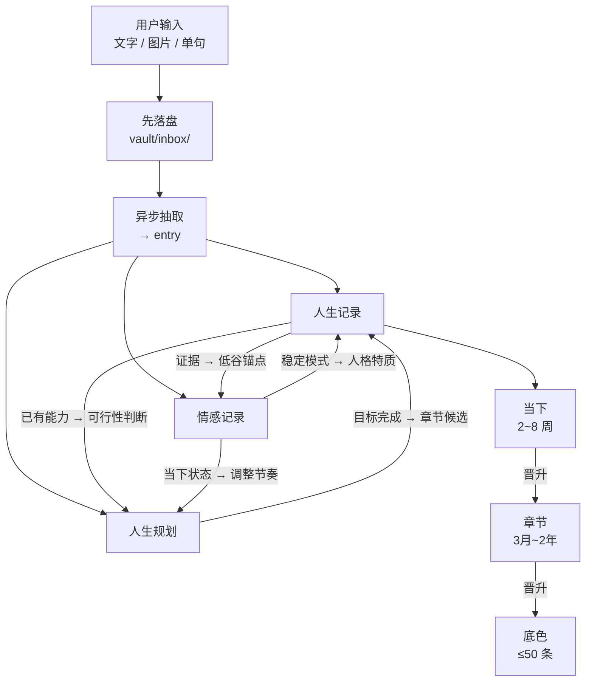

# How Is Your Life「你过得怎么样」· 施工说明书

> 这是一份**施工说明书**，不是宣传文档。
>
> 读者是接手开发的 AI。读完应该能直接开工，不需要再问设计问题。
>
> 人类读者（项目所有者）请从 §0.3 术语表开始看，那里解释所有技术词。

---

## §0 这份文档怎么用

### §0.1 项目一句话

**How Is Your Life（你过得怎么样）** 是一个本地运行的 AI 人生记录工具：用户输入自己做了什么、在想什么、想达成什么，系统整理成精准的短记录，分层保存（当下 / 章节 / 底色），在用户需要时把"他曾经做到过"的证据递到他手上。

> 名字说明：项目名是 **How Is Your Life**；「人生记录」是它三个部分之一，不要混用。

**它不是简历生成器、不是待办清单、不是心理咨询、不是打卡 App。**

### §0.2 硬性约束（5 条，不可违反）

| # | 约束 | 具体要求 |
|---|---|---|
| **C1** | **所有文件必须放在工作区内** | 项目根目录 = 当前工作区根目录。代码、数据、文档、配置、日志全部在其下。**禁止**写入工作区之外的路径（不写 `~/`、不写系统临时目录、不写 `/tmp`）。用户数据目录为 `<工作区>/vault/` |
| **C2** | **必须同时交付说明文档** | 每个功能模块都要有一份 `docs/features/<模块>.md`，用人话解释"这个功能是怎么实现的"。规范见 §9。**没有说明文档的功能视为未完成** |
| **C3** | **不存图片原图** | 图片处理完只保留 OCR 全文 + 摘要 + 可选缩略图。原文见 §5.5 |
| **C4** | **全 API，不本地部署模型** | 不引入 Ollama、不下载模型权重。所有推理走 HTTP API |
| **C5** | **录入必须先落盘** | 用户输入先写入磁盘再异步抽取。断网时录入仍然成功 |

### §0.3 术语表（先看这个）

| 词 | 大白话 | 在本项目里 |
|---|---|---|
| **entry（条目）** | 一件事的档案卡 | 一条输入的整理结果，是系统的最小单位。代码里叫 `entry`，之前文档里叫 `claim`，同一个东西 |
| **schema（字段表）** | 表格有哪些列 | `entry` 有 did/minutes/outcome/emotion 等固定字段，见 §3.4 |
| **锚点** | 具体到编不出来的细节 | 技术名、报错原文、数字、链接、人名。判断记录是否合格的核心标准 |
| **带锚点的压缩** | 短，但锚点全留 | "接通 OAuth，卡点为 state 参数签名"（32 字）而非"今天做了登录功能" |
| **底色 / 章节 / 当下** | 人生的三个时间尺度 | 三层记录结构，见 §3.1。**不要用 L1/L2/L3 命名**（会和证据分级冲突） |
| **接触 / 复现 / 产出 / 能讲** | 四种证据强度 | 判断"学过"还是"会"，见 §3.3。**不要用 L0-L3 命名** |
| **晋升** | 从短层升到长层 | 靠证据累积，不靠时间流逝，见 §3.2 |
| **prompt** | 给 AI 的指令 | 附在每次 API 请求前面的一段文字 |
| **抽取** | 把一段话变成一张档案卡 | `entry` 的生产过程。调 AI 一次 |
| **固化** | 把零散条目合并成阶段主题 | 每周一次，产出 `chapter` |
| **token** | 计费与长度单位，约等于"字" | 中文 1 字 ≈ 1~2 token |
| **context（上下文）** | AI 一次能同时看到的内容 | 有上限，所以要分层、要检索，不能全塞 |
| **embedding（向量）** | 把文字变成一串数字 | 意思相近的数字也相近，实现"按意思搜" |
| **rerank** | 粗筛后精排 | 先捞 50 条，再挑 5 条 |
| **vault** | 存所有记录的文件夹 | `<工作区>/vault/` |
| **索引** | 书的目录页 | SQLite 数据库，可删可重建，正文永远在 markdown 里 |
| **幂等** | 重复执行不产生重复结果 | 断网重试不会存两条一样的 |
| **provider** | 模型厂商 | DeepSeek / 通义 / 硅基流动等 |

### §0.4 开工前必读的三条

1. **不要一次做完。** 按 §10 的四周顺序，每完成一周停下来让用户确认。
2. **不要过度设计。** MVP 只做 CLI，不做前端框架、不做服务端、不做账号系统。
3. **不确定时问，不要猜。** 设计已经足够细，缺的是执行细节；碰到文档没写的，问用户。

---

## §1 项目定位

### §1.1 要解决的问题

人在低谷里失去的不是情绪控制力，而是**记忆的连续性**。

你会觉得"我一直都这么废"，但实际上三个月前你刚做完一个项目、半年前你解决过一个当时以为解决不了的问题。那些事不是忘了，是崩溃的时候想不起来。所有笔记软件只负责"存下来"，不负责"在需要的时刻递到你手上"。

**所以核心不是记录，是在正确的时刻把证据递给你。**

### §1.2 不是什么

- ❌ 简历生成器（简历是顺带产物）
- ❌ 待办清单 / 习惯打卡（打卡靠负罪感驱动，是这类项目头号死因）
- ❌ 心理咨询（边界见 §7.4）
- ❌ AI 夸夸机（每次说"你已经很棒了"的产品，三天被关掉）

---

## §2 系统总览

### §2.1 三个部分

| 部分 | 职责 | 回答的问题 | 对应字段 |
|---|---|---|---|
| **人生记录** | 做过什么、会什么 | "我会什么？我是什么样的人？" | `entry` / `chapter` / `core` |
| **人生规划** | 想去哪、走到哪了 | "我现在该干什么？" | `goal` |
| **情感记录** | 怎么感受、怎么想 | "我为什么难受？我是谁？" | `entry.part = emotion` + `portrait` |

**这三个不是三个模块，是同一份数据的三个视角。** 一条"今天把登录做完了"：

- 人生记录视角 → 一个当下条目，章节证据 +1
- 人生规划视角 → "学完后端"这个目标的进度
- 情感记录视角 → 如果附了"终于不卡了，松了口气"，那是情绪曲线上的一个点

### §2.2 数据流



### §2.3 职责边界（重要）

- **人生记录只记事实**，不做评价、不打分、不给建议
- **人生规划只谈路径**，不评判目标该不该有
- **情感记录只接住人**，不急着解决问题

三者混在一起会全部失效。比如在记录事实的地方写一句"你其实很有潜力"，事实就被污染了，而这句话三个月后毫无用处。

---

## §3 数据模型

### §3.1 三层记录

| 层 | 名称 | 时间尺度 | 单位 | 数量上限 | 文件位置 |
|---|---|---|---|---|---|
| 短 | **当下** | 2~8 周 | entry | 不限，到期归档 | `vault/now/YYYY-MM/` |
| 中 | **章节** | 3 月~2 年 | chapter | 活跃 15~20 | `vault/chapters/` |
| 长 | **底色** | 无期限 | core item | **50 条封顶** | `vault/core.md` |

**为什么要分层**：不分层，一年后就是 2000 条等价信息，没有重量差别就无法判断什么重要。分层是给信息赋予权重和寿命。

**三层在上下文里的分工**（这是分层真正的意义）：

| 场景 | 喂给 AI 的内容 | 量级 |
|---|---|---|
| 日常对话 | 当下最近 30 天 + 活跃章节标题 | ~2k token |
| 周回顾 | 本周全部 entry | ~5k |
| 季度回顾 | 全部活跃 chapter + core | ~10k |
| 低谷干预 | core + 情绪模式 + 相关具体 entry | ~8k |

**永远不要**把全部记录塞进上下文。长上下文不是记忆方案。

### §3.2 晋升规则

> **晋升靠证据累积，不靠时间流逝。** 放三个月不会自动变成章节。

**当下 → 章节**，三条同时满足：

1. **重复**：同一主题在 ≥2 个不同月份出现
2. **产出**：有可验证的产出物（repo / 上线地址 / 笔记 / 通过测试）
3. **厚度**：至少 3 条独立 entry 指向它

**章节 → 底色**，三条同时满足：

1. **跨阶段**：跨 ≥2 个完整章节
2. **独立产出**：至少一次不依赖教程的产出
3. **迁移**：在原始场景之外被用过（新项目 / 讲给别人 / 解决新问题）

**"迁移"是必选项**。只在教程里跑通的东西不算"会"，简历和面试都经不起追问。

**晋升流程：系统提名 → 用户确认 → 生效。**
绝不自动晋升。因为"我以为你重视这个"经常是错的，错判一次用户就不再信任系统。

**每次晋升必须生成一条可见记录**（写入 `vault/changelog.md`），格式：

```
2026-12-01 晋升 OAuth 调试：当下 → 章节「找实习期的主线」
依据：跨 10/11 月、PR #12、共 6 条记录
```

### §3.3 证据分级

每条 entry 对某个能力的贡献强度，四档：

| 档 | 名称 | 含义 | 识别信号（正则/关键词） |
|---|---|---|---|
| 0 | **接触** | 看过、听过 | `学了 / 看了 / 了解了 / 读完了` |
| 1 | **复现** | 有引导的复现 | `照着 / 跟着教程 / 学完做了一遍` |
| 2 | **产出** | 有东西能拿出来 | 有 repo/链接/截图；`自己 / 独立 / 从零 / 上线 / 部署` |
| 3 | **能讲** | 能解释、能迁移 | `讲给 / 教 / 帮别人看 / 写文档`；定位了非平凡 bug |

规则：

- 有产出物链接 → **至少 2 档**
- 出现"报错 → 找到原因 → 修好"且有具体原因 → **至少 2 档**（debug 是强证据）
- 只出现 0 档信号 → 判为 0 档
- **不确定时问一句**（一次，一个问题，不阻塞录入）："这个能跑起来了吗？有代码吗？"用户不答就按原判

**技能展示按等级分布，不按条数。** 20 条接触不如 1 条产出。

### §3.4 字段定义

#### entry（条目）— 一个文件一条

文件：`vault/now/YYYY-MM/YYYYMMDD-HHMMSS.md`

```markdown
---
id: 20261125-143200
ts: 2026-11-25T14:32:00+08:00
part: record              # record | plan | emotion
did: "接通 OAuth 登录，卡点为 state 参数签名"
minutes: 240
outcome: done             # done | stuck | dropped
anchors:                  # 锚点，至少一个
  tech: ["OAuth", "state 参数"]
  people: []
  link: ""
emotion:
  valence: -0.5           # -1..1
  arousal: 0.6            # 0..1
  trigger: "文档不清"
  quote: ""               # 可选，一句话原话，可全局关闭
level: 2                  # 0接触 1复现 2产出 3能讲
goal: "学完后端基础"       # 可空
chapter: ""               # 晋升后回填
blockers: ["state 参数要签名"]
private: false            # true = 全部本地处理，不发给任何 API
status: settled           # pending | settled | needs_review
---
接通 OAuth 登录，卡点为 state 参数签名；后端流程已通，前端待接。
```

正文限制 **60 字**，必须是带锚点的压缩（规范见 §5）。

#### chapter（章节）

文件：`vault/chapters/<slug>.md`

```markdown
---
id: 2026-autumn-oauth
title: "OAuth 调试"
started: 2026-10-12
layers: [now]             # 当前所在层
entry_count: 6
level_max: 2              # 组内最高证据档
status: active            # active | dormant | promoted
last_evidence: 2026-11-25
---
10 月到 11 月，在 OAuth 上卡了三次，最后靠读源码解决。
```

#### core（底色）

文件：`vault/core.md`，**一个文件装全部（≤50 条）**

```markdown
## 会调试陌生代码
- 证据：3 个章节（OAuth 调试 / 爬虫反爬 / 依赖冲突），11 条 entry
- 最高档：产出
- 首次：2025-03 ｜ 最近：2026-11
- 能讲：「我不看文档也能把一个陌生库跑起来，靠读源码和打日志。」
- 状态：fresh             # fresh | rusty
- pinned: false
```

`rusty` 的判定：`最近实践 > 12 个月`。**底色永不降级**，只标 rusty——"会过但现在手生" ≠ "没会过"。rusty 时给一个 30 分钟复健任务。

#### goal（目标）

文件：`vault/goals/<slug>.md`

```markdown
---
id: 2026-fall-backend
title: "学完后端基础"
horizon: term             # short(2周~1月) | term(1学期~半年) | long(1~3年)
why: "想能自己做一个完整的网站"
started: 2026-09-01
due: 2027-01-15
status: active            # active | done | stopped | paused
progress_mode: derived    # derived（默认，从 entry 推） | manual
parent: ""                # 上级 goal id，最多三层
---
```

**没有 "完成百分比" 字段。** 进度靠查询 entry 得出，见 §6.2。

#### portrait（画像）

文件：`vault/portrait/YYYY-QN.md`，每季度一份，**含 diff**

```markdown
## 2026-Q4

### 我现在的假设
- 我猜你在被否定时会先缩起来，而不是争辩。（依据：3 次类似场景）

### 相对上季度的变化
- ~~拖延型~~ → 不是拖延，是"对别人安排的事没动力"。自己选的事你都提前做完。
```

**写假设，不写结论。** 理由见 §7.3。

### §3.5 存储格式

**真相源 = markdown + git。SQLite 只是可重建的索引。**

```
<工作区>/
├── life/                      # 代码
│   ├── cli.py                 # 命令入口
│   ├── store.py               # markdown 读写
│   ├── index.py               # SQLite 索引
│   ├── extract.py             # 抽取
│   ├── llm.py                 # 模型网关
│   ├── retrieve.py            # 三路检索
│   ├── promote.py             # 晋升
│   ├── review.py              # 回顾生成
│   └── prompts/               # 所有 prompt 放在这里，纯文本
├── vault/                     # 用户数据（gitignore）
│   ├── inbox/                 # 落盘未抽取
│   ├── now/YYYY-MM/           # 条目
│   ├── chapters/
│   ├── goals/
│   ├── portrait/
│   ├── media/                 # 缩略图 + OCR 全文
│   ├── core.md
│   ├── corrections.md         # 用户纠错，优先级最高
│   ├── changelog.md           # 晋升记录
│   └── index.sqlite
├── data.example/              # 示例数据，进仓库
├── docs/
│   ├── DESIGN.md              # 本文件
│   └── features/              # 说明文档（§9）
├── tests/
├── README.md
├── providers.yaml
└── requirements.txt
```

SQLite 表：

```sql
entries(id TEXT PRIMARY KEY, ts TEXT, part TEXT, did TEXT, minutes INT,
        outcome TEXT, level INT, goal TEXT, chapter TEXT, valence REAL,
        arousal REAL, trigger TEXT, private INT, status TEXT)
entries_fts(did, body)                     -- FTS5 全文
vec_entries(entry_id TEXT, embedding BLOB) -- 向量（sqlite-vec 或朴素余弦）
chapters(id, title, status, level_max, entry_count, last_evidence)
core(name, level_max, first_at, last_at, status)
goals(id, title, horizon, status, due)
usage(ts, task, model, tokens_in, tokens_out)   -- 成本记账
```

**`life reindex` 必须能从 markdown 完整重建全部索引。** 这是硬性验收项。

---

## §4 功能规格

每个模块的验收标准都是**可执行的检查**，不是"感觉能用"。

### §4.1 M1 录入

**做什么**：接收用户输入，立刻落盘，返回成功。

```
life add "今天把 OAuth 调通了，卡在 state 参数签名，调了 4 小时"
life add --image ./screenshot.png "项目截图"
life add --emotion "今天很累，什么都不想做"
life add --private "这句只存本地"      # 不发给任何 API
```

**流程**：

1. 写入 `vault/inbox/<id>.json`（原文 + 时间 + 参数）→ **落盘这一步就已经成功**
2. 抽取 → 生成 entry → 写入 `vault/now/` → 建索引
3. 抽取失败 → 保留在 inbox，`life retry` 可重试

> **实现说明（2026-11-25）**：MVP 是命令行工具、没有常驻服务，所以「后台队列异步抽取」落地为**先落盘 + 在同一个命令里同步抽完再返回**。用户敲完要等 2~4 秒，换来的是每一步都可见、出错直接报在屏幕上。（被否掉的替代方案：起一个隐藏的后台子进程——快，但失败时屏幕上什么都不显示，极难排查。）
>
> 断网时 `life add` 仍然成功、退出码 0，记录留在 inbox 等 `life retry`。这条不改变 C5 的任何要求。真正的后台队列留到有常驻服务时再说。

**验收**：

- 断网时 `life add` 仍然成功，退出码 0
- 同一条内容重复提交，不产生两条 entry（幂等：按 `content_hash` 去重）
- `--private` 的记录文件里 `private: true`，且 `life ask` 检索不到它

### §4.2 M2 抽取

**做什么**：一段话 → 一张符合 §3.4 schema 的 entry。

**要求**：

- 必须用**结构化输出**（JSON Schema / json_object），**禁止**"请输出 JSON"然后祈祷 parse 成功
- 三级降级：`json_schema` → `json_object` + 客户端校验 → 纯文本提取代码块 + 校验
- 校验失败重试一次（把错误信息回喂），两次失败标 `status: needs_review`，**不静默丢弃**
- 缓存键 `(content_hash, prompt_ver, model)`

**prompt 放在 `life/prompts/extract.md`，不要硬编码在 Python 里。** 规范见 §5。

**验收**：

- 跑 20 条真实输入，`did` 字段全部 ≤60 字，且**每条至少含一个锚点**
- 0 条 `did` 是"今天做了某事"这类无锚点表述
- 乱码/空输入不崩溃

### §4.3 M3 检索（三路混合）

**做什么**：给一个查询，返回最相关的 entry。

| 路 | 方法 | 用途 | 实现 |
|---|---|---|---|
| 1 | 向量相似 | 找同类内容 | embedding + 余弦 |
| 2 | 全文 + 实体 | 找特定人/项目/技术 | FTS5 + anchors 过滤 |
| 3 | **结构检索** | 时间与情绪 | SQL |

第 3 路最容易被忽略，但**是这个项目的关键**：

```sql
-- 上次说类似的话是什么时候（情绪极点倒序）
SELECT * FROM entries WHERE valence < -0.5 ORDER BY ts DESC LIMIT 10;
-- 去年今天
SELECT * FROM entries WHERE substr(ts,6,5) = substr(?,6,5) AND substr(ts,1,4) = ?-1;
-- 那次之后怎么恢复的（低谷之后的第一个 done）
SELECT * FROM entries WHERE ts > ? AND outcome = 'done' ORDER BY ts LIMIT 3;
```

合并：三路各取 10 条，去重，rerank 取前 5~8 条。

**验收**：

- 输入"我好累"，能返回 ≥1 条 30 天前的负面情绪 entry（说明结构检索生效）
- 输入一个人名，能返回所有相关 entry
- `--private` 的 entry 在任何一路都不出现

### §4.4 M4 对话

**做什么**：`life ask "..."`，带旧记录回答。

**上下文组装（每次必须按此结构）**：

```
[system]  人设 + 禁止清单（§7.2）+ 用户选定的 voice
[context] core 摘要（≤50 条压成 15 行）
          + 相关章节标题（只是标题，不带全文）
          + 三路检索召回的 entry 5~8 条（带日期）
          + 最近 3 天 entry
[user]    用户的输入
```

**生成时强制三件事**：

1. **一个具体的旧细节**（带日期）
2. **一个纵向对比**（"这次跟三月那次不一样……"）
3. **一个小到可拒绝的下一步**

**验收**：

- 输出中至少出现一个真实存在的历史日期
- 不出现禁止清单里的任何句式（写测试用例断言）
- 上下文总长 ≤15k token（超了就减召回条数）

### §4.5 M5 目标（人生规划）

```
life goal add "学完后端基础" --horizon term --why "想自己能做一个网站"
life goal list
life goal done <id>        # 用户说了算，系统不拦
life goal stop <id> --reason "发现更想做前端"
```

**进度展示用证据视图，不做百分比**：

```
## 学完后端基础    2026-09 → 现在
42 条记录 ｜ 投入 ~65h ｜ 最近 3 天活跃

证据分布
  能讲      1 条   给同学讲了 JWT 刷新
  产出      5 条   api-server（repo）、部署上线、N+1 优化
  复现     12 条
  接触     24 条

能拿出手的：…
还缺：…
```

`life goal done` 时不校验证据，但**卡片要照实展示分布**。全接触的话显示"以接触为主，缺少独立产出"。

**AI 在目标上做四件事**：

1. 拆解成这周能做的 3 件事，每件小到不可能失败
2. 从记录诊断卡点（"你 5 次技术目标都在第 9 天停"）
3. 目标停下时问："是这条路不想走，还是方法走不通？"
4. 目标太多时提异议

**禁止**：替用户定目标、催进度、发提醒、做 KPI 面板、标红未完成、连续天数。

### §4.6 M6 固化与晋升

```
life settle --week          # 把本周 entry 归纳成章节候选
life promote                # 交互式处理晋升提名
```

`settle` 每周跑一次：读本周全部 entry → 识别主题 → 若满足 §3.2 条件则写入 `changelog.md` 作为**提名**，等用户 `life promote` 确认。

> **实现说明（2026-11-25）**：这里和 §3.2 有一处对不上——只看「本周」的记录，永远不可能满足「同一主题在 **≥2 个不同月份**出现」。
>
> 落地的分工是：**本周记录用来「发现」主题，主题里的关键词用来把历史记录「串」起来**，条件检查跑在串完之后的全部记录上（`life/promote.py::_回连`，prompt 里要求模型额外给出 2~4 个 `keywords`）。
>
> 被否掉的两个解法：「settle 改成读全部记录」（记录多了成本失控，也违背「每周一次」）；「放宽条件不要求跨月」（一周的兴致不能算主线）。

**验收**：

- 造 3 条跨两个月的同类 entry，`life promote` 能提名
- 拒绝提名后不再重复提同一条
- 晋升后 entry 的 `chapter` 字段被回填

### §4.7 M7 画像

```
life portrait               # 生成/更新本季度画像
life portrait --diff        # 只看变化
```

季度一次。读 core + 全部活跃 chapter + 情绪模式，写出**假设清单 + 相对上季度的 diff**。

**验收**：输出里每条假设都带"依据：N 次类似场景"；diff 保留被推翻的旧假设（用删除线），不直接覆盖。

### §4.8 M8 回顾

```
life review --week
life review --quarter --html > review.html
```

输出一份 markdown（可选生成单文件 HTML，双击可看）。内容：本周做了什么 / 证据分布变化 / 情绪曲线 / 晋升事件 / 下周一个建议（只给一个）。

**`--html` 不引入前端框架**，用 Python 字符串模板拼一个自包含 HTML。

> **实现说明（2026-11-25）**：这里说的「单文件 HTML、双击可看、不引入前端框架」的**展示部分**已提前到第 1 周实现，命令名 **`life board`**，产物是 `vault/看板.html`：按月分组的记录卡 + 证据档位分布 + 情绪曲线，全部数据来自 `vault/now/` 的 markdown，无外链、不联网、不起服务。
>
> §4.8 要求的「证据分布**变化** / 晋升事件 / 下周一个建议」**仍在第 4 周**——它们依赖第 3 周的晋升和第 4 周的画像，现在硬做只能是假数据。`life review` 本身也还在第 4 周。

---

## §5 记录写法规范

### §5.1 核心原则

记录要**精准，不是完整**。但"精准"不等于"摘要"：

| 做法 | 产出 | 问题 |
|---|---|---|
| 一字不差 | 原文照抄 | 占空间、无法检索、没有重量 |
| 摘要 | "今天做了登录功能" | **丢掉锚点**，三个月后完全没用 |
| ✅ **带锚点的压缩** | "接通 OAuth，卡点为 state 参数签名；后端已通，前端待接" | 短，但能拿来用的东西都在 |

**判断标准一句话**：三个月后看到它，能不能立刻讲出一个具体细节？

### §5.2 四条规则（写进 extract prompt）

1. **留锚点，丢修饰**：技术名、数字、报错、链接、人名要留；"烦死了""总算""不容易"丢进 `emotion`，不进正文
2. **句式 = 动作 + 对象 + 结果 + 卡点**，不用"感觉 / 体会 / 收获很大"
3. **一条只讲一件事**：讲了 3 件事就拆成 3 条，否则检索互相污染
4. **长度上限**：正文 60 字，章节标题 15 字

### §5.3 正反例（作为 prompt 的 few-shot）

用户原话：

> 今天又在搞那个 oauth 的登录，烦死了，文档写得跟屎一样，试了半天发现 state 参数要签名，弄完已经一点多了，不过总算跑通了，明天还得接前端

| | 产出 |
|---|---|
| ❌ 一字不差 | 全文照抄（87 字，无法检索） |
| ❌ 过度摘要 | `did: "今天做了登录功能"`（锚点全丢） |
| ✅ 精准 | `did: "接通 OAuth 登录，卡点为 state 参数签名；后端流程已通，前端待接。"` |
| ✅ 情绪 | `emotion: {valence: -0.5, arousal: 0.7, trigger: "文档不清"}` |
| ✅ 原话 | `quote: "文档写得跟屎一样"` |

### §5.4 关于原话

`emotion.quote` 保存**一句话级别的原话**，全局可关闭（`settings.keep_quote`）。

理由：三个月后安慰用户时，"你当时说'文档写得跟屎一样'"和"你当时情绪低落"，力量完全不同。这是全文唯一保留的原文。

### §5.5 图片处理

**不存原图。** 一次视觉调用，产出三样，只存后两样：

```json
{
  "ocr_text": "…截图里全部文字，逐行保留，不概括…",
  "digest": "项目截图：带侧边栏的管理后台，React + Express，已完成登录和列表页",
  "claims": [{ "did": "…", "level": 2 }]
}
```

- `ocr_text` **必须是全文**——OCR 是确定性事实，摘要一次就永久丢失；原图删了以后，它是那张图唯一的"原话"
- 缩略图（160px，约 5KB）可选保留
- 单条覆盖：`--keep-image` 保留原图（设计稿、手写笔记这类文字替代不了的）

---

## §6 模型接入

### §6.1 分工

| 任务 | 档位 | 备注 |
|---|---|---|
| 抽取 | 便宜快（mini/flash 级） | 量大，必须结构化输出 |
| 固化 / 画像 | 中强档 | 30k 上下文 |
| 对话 | 最强档付得起的 | **产品命门，不要省** |
| 视觉 | 多模态中档 | 一次调用产 OCR + 摘要 |
| Embedding | 专用向量模型 | 需支持 batch |

**很多聊天厂商没有 embedding 接口**，所以必须支持**每个 task 独立配 provider**。

### §6.2 配置

`providers.yaml`（用户自己填 key）：

```yaml
providers:
  chat:    { base_url: https://api.deepseek.com/v1, api_key_env: CHAT_API_KEY }
  vectors: { base_url: https://api.siliconflow.cn/v1, api_key_env: VEC_API_KEY }

tasks:
  extract:     { provider: chat,    model: <便宜档>, json: strict }
  settle:      { provider: chat,    model: <中强档> }
  dialogue:    { provider: chat,    model: <最强档> }
  vision:      { provider: chat,    model: <多模态档> }
  embed:       { provider: vectors, model: bge-m3, batch: 64 }
  rerank:      { provider: vectors, model: bge-reranker-v2-m3 }
```

模型名不要写死在代码里，统一从配置读。

### §6.3 三条工程约束

1. **落盘优先**（C5）：录入成功与抽取成功解耦
2. **幂等 + 缓存**：键 `(content_hash, prompt_ver, model)`
3. **成本可观测**：每次调用写 `usage` 表，`life cost` 输出本月消费。**用户看不到花费就不敢用**——这个心理门槛比账单更阻碍使用

### §6.4 成本量级

每天 5 条记录 + 3 轮对话 → **月 10~50 元**。对话那档模型决定 80% 账单。所以策略明确：抽取抠到最便宜，对话用好的。

---

## §7 情感记录与画像

### §7.1 三个时间尺度的产出

| 尺度 | 产出 | 用途 |
|---|---|---|
| 当下 | 情绪状态 + 一句回应 | 当天 |
| 阶段 | 情绪模式："每次面试前 3 天你会失眠并想放弃" | 下次提前预警 |
| 长期 | **你是什么样的人** | 画像、低谷锚点 |

### §7.2 禁止清单（必须写进 system prompt）

- ❌ "你已经很棒了 / 相信自己 / 一切都会好的"
- ❌ 复述用户刚说的话
- ❌ 一次给三条以上建议（父母只给一句）
- ❌ 急着解决情绪（先接住）
- ❌ **附和自我贬低**（"听起来你确实不太行"）

最后一条要精细处理：**不附和 ≠ 否认感受**。正确形态是——

> 承认感受，拒绝结论。
> "累是真的。'我不行'这个结论我不认，证据在这儿。"

### §7.3 三种干预模式（用户显式选）

| 模式 | 做什么 | 场景 |
|---|---|---|
| `mirror` 镜像 | 只复述事实和模式，不评价 | 想自己看清 |
| `coach` 教练 | 给一个下一步 | 想动但不知动哪 |
| `friend` 朋友 | 先接住情绪 | 只想被听见 |

**写记录时默认不触发 AI 回应。** 安慰必须是用户主动点进去的动作——如果写什么都回一大段，用户就不写了。

### §7.4 边界（必须实现）

- 不做心理诊断
- 不做价值判断（不说"你应该分手 / 应该辞职"）
- 持续负面或自伤倾向 → 给现实求助资源，明确说明这不是专业帮助
- **主动把人推回现实**："这件事你要不要跟你导师说一句？"

最后一条是底线：如果它永远耐心、永远记得、永远不评判，真人会显得很差。**这个产品不该成为用户不找真人的理由。** 这一句要写进 README。

### §7.5 画像：写假设，不写结论

- ✅ "我猜你在被否定时会先缩起来，而不是争辩。（依据：3 次类似场景）"
- ❌ "你是一个内向、缺乏自信的人。"

两个理由：固定标签必然滑向巴纳姆效应；**父母会记错你的事，能承认自己记错，比全知更像真的**。

---

## §8 隐私（硬性）

| 要求 | 实现 |
|---|---|
| 数据默认纯本地 | `vault/` 默认进 `.gitignore`，仓库只放 `data.example/` |
| 零遥测 | 不发任何统计 |
| `private: true` | 该条不进任何 API 调用，不进检索、不进 embedding |
| Key 与数据分离 | 环境变量或钥匙串，绝不进 vault、绝不进日志 |
| README 说明 | 哪些数据出网、发到哪、用途，写清楚 |

这一条做不好，用户（包括三个月后的项目所有者）会在某次崩溃后想删库。

---

## §9 说明文档要求（C2 的具体定义）

**每个功能模块必须有一份 `docs/features/<模块>.md`**，面向"第一次做项目的人"，要求：

### §9.1 固定结构（五节，缺一不可）

1. **这个功能对用户是什么** —— 用生活语言描述，不带任何技术词
2. **一次调用的完整路径** —— 用户敲了什么 → 程序做了什么 → 数据落到哪个文件 → 数据库变了什么。用箭头列表，能配一个 ASCII 图更好
3. **关键代码在哪** —— 文件路径 + 函数名 + 一句话作用。例如：
   ```
   life/extract.py::extract_entry()   调模型，把一段话变成 entry
   life/store.py::write_entry()       把 entry 存成 markdown
   ```
4. **为什么这么设计** —— 这个功能里最容易被做错的一个决定，以及为什么选了现在这条。要写出被否掉的替代方案
5. **已知限制** —— 现在做不到什么，什么情况下会出错

### §9.2 要求

- **用人话**，不要只贴代码
- **必须能对上代码**：写完自己按文档点一遍，路径和函数名要对
- 每个功能至少 300 字，不超过 800 字
- 技术词第一次出现时用括号解释

### §9.3 必须有的两份总文档

- `README.md` —— 一句话定位、截图/demo、安装三步、隐私声明、"这不是心理咨询"、"功能与代码对照表"
- `docs/features/README.md` —— 索引表：功能 → 说明文档 → 主要代码文件

**「功能与代码对照表」示例**：

| 功能 | 说明文档 | 主要代码 |
|---|---|---|
| 录入 | `docs/features/录入.md` | `cli.py`, `store.py` |
| 抽取 | `docs/features/抽取.md` | `extract.py`, `prompts/extract.md` |
| 检索 | `docs/features/检索.md` | `retrieve.py`, `index.py` |

---

## §10 路线图（按此顺序，每阶段停下等确认）

| 周 | 交付 | **验证什么**（这是重点） |
|---|---|---|
| **1** | vault 结构 + `life add`（文字/图片/单句）+ 抽取 + 索引 + **`life board` 只读看板** | 能不能低摩擦写进去；锚点是否真的留住 |
| **2** | 三路检索 + `life ask` | **它能不能提起我忘了的事** ← 全项目的验证点 |
| **3** | 目标 + 证据视图 + `settle` + 晋升 | 分层是否成立 |
| **4** | 情感记录 + 画像 + 回顾 + README + demo 数据 | 画像是否让人有共鸣 |
| **5** | **`life server`：可编辑网页界面**（新建/修改目标、确认 `needs_review`） | 写操作是否安全：会不会把用户的记录改坏 |

**第 2 周是整个项目的命门。** 如果它提不起你忘掉的事，后面全是空的——那时候要停下来重新想，不要往下铺功能。

> **路线图变更（2026-11-25）**：原设计是四周。第 5 周是项目所有者在第 1 周验收后追加的——第 1 周交付的 `life board` 只能看不能改，满足不了「在网页里设目标」的需求。
>
> 这一条同时把 §11「不做服务端」的作用范围限定为**第 1~4 周的 MVP**。第 5 周的服务只绑 `127.0.0.1`，不对外、不引入前端框架（原生 HTML + 表单提交），数据仍然只在本机。
>
> 第 5 周第一版**只做两件事**：① 新建 / 修改目标；② 把 `needs_review` 的记录勾成 `settled`。不做批量编辑、不做富文本、不做拖拽排序。
>
> **开工前必读 §4.5 的禁止清单**：不替用户定目标、不催进度、不发提醒、不做 KPI 面板、不标红未完成、不连续天数。做编辑界面时最容易顺手加「进度条」和「连续记录 N 天」，那正是这个产品要避免的。

### §10.1 每周交付时同时交付

- 功能代码
- 对应的 `docs/features/*.md`（§9）
- 至少 3 个测试
- 一句话告诉用户"这周能怎么试"

### §10.2 MVP 之后（不在第一轮范围）

手机入口（Telegram bot）、语音输入、周年触发、面试模式（从底色生成 STAR 卡 + AI 扮面试官）、章节→底色的 50 条挤出机制。

> 这份清单里原本还有「Web 界面」，已改为第 5 周的可编辑界面，见 §10 路线图。

---

## §11 不做的事

- 社交、分享、排行榜
- 云同步（第一版）
- 自动打卡、提醒轰炸
- 给用户打分、评级、"人生进度条"
- 前端框架 / 服务端 / 账号系统（MVP 只要 CLI）
  - **唯一例外**：第 5 周的可编辑界面需要一个本机服务，只绑 `127.0.0.1`、不对外、不用前端框架。见 §10。
- 本地模型部署（C4）

---

## §12 自检清单（交付前逐条打勾）

- [ ] 所有文件都在工作区内，没有写到外部路径（C1）
- [ ] 每个功能都有 `docs/features/*.md`，五节齐全（C2 / §9）
- [ ] 图片不存原图，`ocr_text` 是全文（C3 / §5.5）
- [ ] 无本地模型依赖（C4）
- [ ] 断网时 `life add` 仍成功（C5 / §4.1）
- [ ] `life reindex` 能从 markdown 完整重建索引（§3.5）
- [ ] 重复提交同一内容不产生两条 entry（§4.1）
- [ ] `--private` 的 entry 不出现在任何检索和 API 调用里（§4.3 / §8）
- [ ] 抽取 prompt 在 `prompts/` 里，没硬编码（§4.2）
- [ ] 有 `data.example/`，`make demo` 能生成一张能力卡和一份画像（§13）
- [ ] README 写明"这不是心理咨询""数据出网范围"（§8 / §7.4）
- [ ] 测试覆盖 ≥3 个用例/模块

---

## §13 demo 数据

仓库必须带一份**虚构的 6 个月记录**（`data.example/`），让 `make demo` 一条命令就能生成：

- 15~20 条 entry（跨 3 个月，含锚点）
- 2~3 个章节
- 5 条底色
- 1 份画像 + diff
- 1 份季度回顾（HTML）

**没有 demo 的仓库没人 clone。** 这份假数据同时也是抽取 prompt 的 few-shot 来源，一举两得。

---

## 附：一句话总结每个部分

- **人生记录**：把做过的事压成带锚点的一句话，按 当下 / 章节 / 底色 三层放好，靠证据往上晋升。
- **人生规划**：立目标、看证据分布、让 AI 拆解和指出卡点，但完不完成用户说了算。
- **情感记录**：写下来，被接住，然后慢慢看出"你是个什么样的人"——用假设的口气，不是判决的口气。
